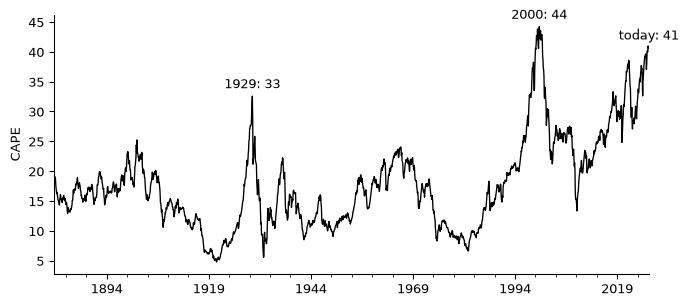
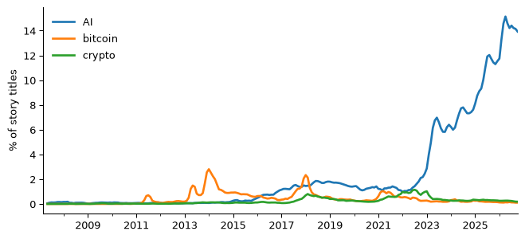

# Is AI a bubble?
MT4008 introduction lecture

## Question

“Is AI a bubble?” cannot be answered directly: nobody can measure a
bubble, and whether it bursts is a prediction, not a fact in any
dataset. So the first job is to turn the vague question into questions
data **can** answer. A bubble is usually described by three signs:

| A bubble means … | We measure | Source |
|:---|:---|:---|
| prices far above what the companies earn | the cyclically adjusted price/earnings ratio (CAPE) of US stocks | Shiller |
| prices that rose unusually fast | the NASDAQ index compared with five years earlier | FRED |
| everybody talking about it | the share of Hacker News story titles that mention AI | HN Search API |

Our question: **how do today’s values of these three signs compare with
earlier booms**, the 1929 crash, the dot-com bubble of 2000 and the
crypto boom of 2017–2021?

## Data

All three were downloaded with `fetch.py` and saved unchanged in
`data/`.

``` python
shiller = pd.read_excel("data/shiller-ie_data.xls", sheet_name="Data", header=None, skiprows=8)
nasdaq = pd.read_csv("data/fred-nasdaqcom.csv")
hn = pd.read_csv("data/hn-title-mentions.csv")
print(shiller.shape, nasdaq.shape, hn.shape)
```

    (1871, 22) (14542, 2) (236, 8)

    /var/folders/c0/ljsmh_md1wqc7ry8qt6jnhv80000gn/T/ipykernel_46077/2435351509.py:1: Pandas4Warning: The xlrd engine is deprecated and will be removed in a future version. Use the calamine engine instead, by setting engine='calamine'.
      shiller = pd.read_excel("data/shiller-ie_data.xls", sheet_name="Data", header=None, skiprows=8)

- **Shiller** (shillerdata.com): monthly S&P composite prices, earnings
  and CAPE from 1871. CAPE divides the price by the average
  inflation-adjusted earnings of the past ten years.
- **NASDAQ Composite** (FRED series NASDAQCOM): the daily close since
  1971, dominated by technology companies.
- **Hacker News**: for every month since March 2007, the number of story
  titles and the number that contain each term as a whole word, from the
  HN Search API by Algolia.

What it cannot tell us: all three describe the *US* market and an
English-speaking tech forum. Hacker News readers are not the public. And
none of it says what the future holds.

## Cleaning

Shiller’s sheet has eight lines of headings and notes at the bottom. Its
dates are numbers like `2026.1`, which means October (`.10`), not
January (`.01`): read as a decimal year it would put October before
February. We rebuild the month from the text.

``` python
shiller = shiller[pd.to_numeric(shiller[0], errors="coerce").notna()]
year_month = shiller[0].map(lambda x: f"{x:.2f}")   # 2026.1 -> "2026.10"
cape = pd.Series(pd.to_numeric(shiller[12], errors="coerce").to_numpy(),
                 index=pd.to_datetime(year_month, format="%Y.%m"), name="CAPE").dropna()
print(f"CAPE {cape.index.min():%Y-%m} to {cape.index.max():%Y-%m}")
```

    CAPE 1881-01 to 2026-10

FRED marks days without a value (holidays) with an empty field. We keep
the month-end close, for complete months only: the data was downloaded
in early November 2026, so we stop at October, the last month all three
sources cover.

``` python
nasdaq["date"] = pd.to_datetime(nasdaq["observation_date"])
close = pd.to_numeric(nasdaq["NASDAQCOM"], errors="coerce")
nasdaq = pd.Series(close.to_numpy(), index=nasdaq["date"]).dropna()
nasdaq = nasdaq.loc[:"2026-10-31"].resample("ME").last()
growth5 = nasdaq / nasdaq.shift(60)   # value now / value five years (60 months) earlier
```

Hacker News grew a lot, so raw counts mostly measure the site’s growth.
We use the **share** of all story titles. A title can contain several
terms, so we do not add them up.

``` python
hn["month"] = pd.to_datetime(hn["month"])
hn = hn.set_index("month")
shares = hn[["AI", "LLM", "GPT", "blockchain", "bitcoin", "crypto"]].div(hn["all_stories"], axis=0)
```

## Exploration

``` python
ax = cape.plot(figsize=(8, 3.5), color="black", lw=1)
for when, label in [("1929-09", "1929"), ("1999-12", "2000"), (cape.index.max(), "today")]:
    v = cape.loc[when] if not isinstance(when, str) else cape.loc[when].iloc[0]
    ax.annotate(f"{label}: {v:.0f}", (pd.Timestamp(when), v), xytext=(0, 6),
                textcoords="offset points", ha="center")
ax.set_ylabel("CAPE")
ax.set_xlabel("")
plt.show()
```

<div id="fig-cape">



Figure 1: CAPE of the S&P composite, 1881 to today.

</div>

``` python
ax = (shares[["AI", "bitcoin", "crypto"]].rolling(3).mean() * 100).plot(figsize=(8, 3.5), lw=2)
ax.set_ylabel("% of story titles")
ax.set_xlabel("")
ax.legend(frameon=False)
plt.show()
```

<div id="fig-hn">



Figure 2: Share of Hacker News story titles that mention each term.

</div>

## Analysis

Where does today’s value of each sign rank in its own history?

``` python
def rank(series, label, unit=""):
    now = series.dropna().iloc[-1]
    return {"sign": label, "today": f"{now:.1f}{unit}",
            "higher than … of all months": f"{(series.dropna() < now).mean():.0%}",
            "record": f"{series.max():.1f}{unit} ({series.idxmax():%b %Y})"}

table = pd.DataFrame([
    rank(cape, "CAPE"),
    rank(growth5, "NASDAQ vs 5 years earlier", "×"),
    rank(shares["AI"] * 100, "HN titles mentioning AI", " %"),
])
Markdown(table.to_markdown(index=False))
```

| sign | today | higher than … of all months | record |
|:---|:---|:---|:---|
| CAPE | 40.7 | 99% | 44.2 (Dec 1999) |
| NASDAQ vs 5 years earlier | 1.6× | 40% | 5.9× (Feb 2000) |
| HN titles mentioning AI | 13.7 % | 97% | 15.9 % (Feb 2026) |

## Conclusions & limitations

On two of the three signs, AI today looks like a boom. US stocks are
priced higher relative to earnings than at any time except the months
around 2000, and higher than before the 1929 crash. Talk about AI on
Hacker News is close to its peak of February 2026, about four times the
highest share bitcoin ever had. The third sign is **not** there: the
NASDAQ is 1.6 times its value five years ago, an ordinary pace (higher
than only 40% of months), far from 5.9 times in 2000.

What the data **cannot** say is whether this is a bubble. High
valuations can last for years, and if AI raises earnings as much as the
market expects, today’s prices may turn out reasonable. In short: *two
of the three signs that preceded earlier crashes are present; whether a
crash follows is not in the data.*

Limitations:

- Three signs are our choice. Others (debt, new investors, company
  spending) could disagree.
- Every source is about the US or an English-language tech forum.
- A word count is a crude measure of attention, and “AI” also matches
  unrelated uses.
- History has only a handful of bubbles to compare with, so “unusual”
  rests on very few cases.

## How to reproduce

    uv sync
    uv run ai-bubble/fetch.py      # optional: downloads the data again (about ten minutes)
    uv run quarto render ai-bubble/report.qmd
