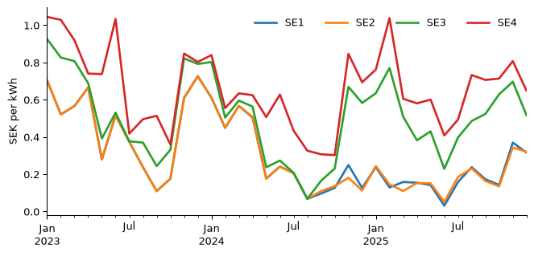

# Why does electricity cost more in Malmö than in Luleå?
MT4008 introduction lecture

## Question

Since 2011 Sweden has four electricity price zones, SE1 (Luleå) in the
north to SE4 (Malmö) in the south. Southern households often pay several
times what northern ones do. **How big is the gap, and how much of it
goes with the weather?** If wind power in the south pushes prices down,
the gap should be smaller on windy days in Malmö.

## Data

Three sources, joined on the date:

``` python
prices = pd.read_csv("data/prices.csv")
prices.head(3)
```

<div>
<style scoped>
    .dataframe tbody tr th:only-of-type {
        vertical-align: middle;
    }
&#10;    .dataframe tbody tr th {
        vertical-align: top;
    }
&#10;    .dataframe thead th {
        text-align: right;
    }
</style>

|     | zone | start                     | end                       | sek_per_kwh |
|-----|------|---------------------------|---------------------------|-------------|
| 0   | SE1  | 2023-01-01T00:00:00+01:00 | 2023-01-01T01:00:00+01:00 | 0.02248     |
| 1   | SE1  | 2023-01-01T01:00:00+01:00 | 2023-01-01T02:00:00+01:00 | 0.01544     |
| 2   | SE1  | 2023-01-01T02:00:00+01:00 | 2023-01-01T03:00:00+01:00 | 0.00101     |

</div>

- **Spot prices** (`data/prices.csv`): the day-ahead price for each zone
  and each hour (each quarter-hour from October 2025), 2023–2025, from
  Nord Pool via the free API at elprisetjustnu.se. Downloaded with
  `fetch_prices.py`. The price is the wholesale price in SEK per kWh,
  without network fees or tax: not what a household pays.
- **Weather** (`data/smhi-*.csv`): SMHI’s quality-controlled daily mean
  temperature and hourly wind speed at Malmö A and Luleå-Kallax. CC BY
  4.0. Downloaded with `fetch_weather.py`.

What it cannot tell us: one weather station per zone is a crude picture
of the weather over the wind farms, and the data says nothing about the
power grid, which is what actually separates the zones.

## Cleaning

Two traps in the price data. In October 2025 the market went from hourly
to 15-minute prices, and twice a year the clocks change, so a day has 23
or 25 hours. A plain mean of the rows would weigh a quarter-hour like an
hour. We weight each price by how long it lasted.

``` python
prices["start"] = pd.to_datetime(prices["start"], utc=True)
prices["end"] = pd.to_datetime(prices["end"], utc=True)
prices["minutes"] = (prices["end"] - prices["start"]).dt.total_seconds() / 60
print(prices["minutes"].value_counts().sort_index().to_dict())  # 75 and 120: clock changes

# The date in Swedish time, not UTC.
prices["date"] = prices["start"].dt.tz_convert("Europe/Stockholm").dt.tz_localize(None).dt.normalize()
prices["weighted"] = prices["sek_per_kwh"] * prices["minutes"]
by_day = prices.groupby(["date", "zone"])
daily = (by_day["weighted"].sum() / by_day["minutes"].sum()).unstack()
daily.shape
```

    {15.0: 35340, 60.0: 96372, 75.0: 4, 120.0: 8}

    (1096, 4)

SMHI’s files start with a block of station information; the table starts
at the line beginning `Datum` (wind) or `Från Datum` (temperature).

``` python
def read_smhi(path):
    with open(path, encoding="utf-8-sig") as f:
        header = next(i for i, line in enumerate(f) if line.startswith(("Datum", "Från Datum")))
    ncols = 4 if "wind" in path else 5   # the columns after these are notes, not data
    return pd.read_csv(path, sep=";", skiprows=header, usecols=range(ncols))

for place in ["malmo", "lulea"]:
    wind = read_smhi(f"data/smhi-{place}-wind-corrected-archive.csv")
    wind["date"] = pd.to_datetime(wind["Datum"])
    temp = read_smhi(f"data/smhi-{place}-temperature-corrected-archive.csv")
    temp["date"] = pd.to_datetime(temp["Representativt dygn"])
    daily = (daily
             .join(wind.groupby("date")["Vindhastighet"].mean().rename(f"wind_{place}"))
             .join(temp.set_index("date")["Lufttemperatur"].rename(f"temp_{place}")))

print("days with missing weather:", daily.isna().any(axis=1).sum(), "of", len(daily))
days = daily.dropna().copy()
days["gap"] = days["SE4"] - days["SE1"]
```

    days with missing weather: 22 of 1096

## Exploration

``` python
monthly = days[["SE1", "SE2", "SE3", "SE4"]].resample("MS").mean()
ax = monthly.plot(figsize=(8, 3.5), lw=2)
ax.set_ylabel("SEK per kWh")
ax.set_xlabel("")
ax.legend(frameon=False, ncols=4)
plt.show()
```

<div id="fig-zones">



Figure 1: Monthly mean spot price per zone.

</div>

``` python
yearly = days.groupby(days.index.year)[["SE1", "SE4", "gap"]].mean().round(2)
Markdown(yearly.to_markdown())
```

| date |  SE1 |  SE4 |  gap |
|-----:|-----:|-----:|-----:|
| 2023 | 0.46 | 0.74 | 0.29 |
| 2024 | 0.29 | 0.57 | 0.27 |
| 2025 | 0.19 | 0.68 | 0.49 |

## Analysis

Split the days into four equally large groups by the wind speed in
Malmö, from the calmest to the windiest quarter, and compare the gap.

``` python
days["wind group"] = pd.qcut(days["wind_malmo"], 4, labels=["calmest", "2", "3", "windiest"])
by_wind = days.groupby("wind group", observed=True)["gap"].agg(["mean", "count"]).round(2)
Markdown(by_wind.to_markdown())
```

| wind group | mean | count |
|:-----------|-----:|------:|
| calmest    | 0.55 |   269 |
| 2          | 0.39 |   269 |
| 3          |  0.3 |   267 |
| windiest   | 0.15 |   269 |

Is the difference between the calmest and windiest quarter more than
chance? A bootstrap: resample the days in each group with replacement,
many times, and see how much the difference moves.

``` python
calm = days.loc[days["wind group"] == "calmest", "gap"].to_numpy()
windy = days.loc[days["wind group"] == "windiest", "gap"].to_numpy()
boot = [rng.choice(calm, calm.size).mean() - rng.choice(windy, windy.size).mean()
        for _ in range(10_000)]
low, high = np.percentile(boot, [2.5, 97.5])
print(f"calm minus windy: {calm.mean() - windy.mean():.2f} SEK/kWh, 95% interval {low:.2f} to {high:.2f}")
```

    calm minus windy: 0.40 SEK/kWh, 95% interval 0.34 to 0.47

How much of the day-to-day gap does the weather explain? A straight-line
fit on wind and temperature in Malmö:

``` python
X = np.column_stack([np.ones(len(days)), days["wind_malmo"], days["temp_malmo"]])
coef, *_ = np.linalg.lstsq(X, days["gap"], rcond=None)
r2 = 1 - (days["gap"] - X @ coef).var() / days["gap"].var()
print(f"each extra m/s of wind: {coef[1]:+.3f} SEK/kWh; share of the variation explained: {r2:.0%}")
```

    each extra m/s of wind: -0.114 SEK/kWh; share of the variation explained: 18%

## Conclusions & limitations

Southern Sweden paid on average about 0.35 SEK/kWh more than the north
in 2023–2025, and the gap grew while northern prices fell. On the
calmest quarter of days in Malmö the gap was several times larger than
on the windiest quarter, a difference far larger than chance would
produce.

But wind and temperature explain only about a fifth of the day-to-day
variation. The rest is what the data does not contain: how much power
the grid can carry from north to south, nuclear plants in maintenance,
and prices on the continent.

Limitations:

- **Correlation, not cause.** Windy days differ from calm days in other
  ways (season, demand).
- One station per zone stands in for the weather over a whole region.
- Spot prices are not household prices.

## How to reproduce

    uv sync
    uv run electricity/fetch_prices.py    # optional: downloads the prices again
    uv run electricity/fetch_weather.py   # optional: downloads the weather again
    uv run quarto render electricity/report.qmd
